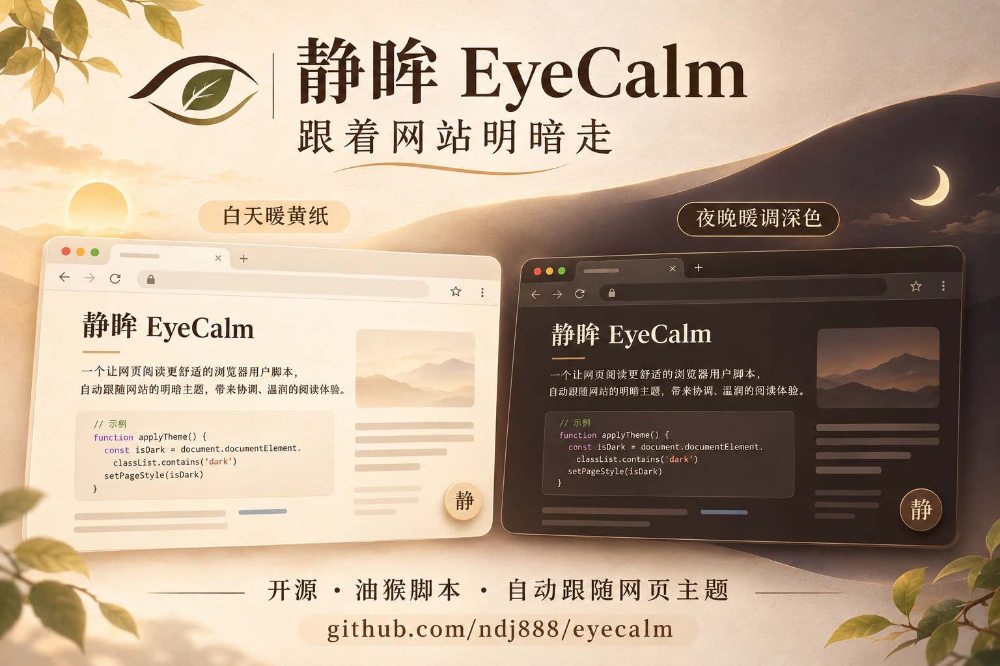
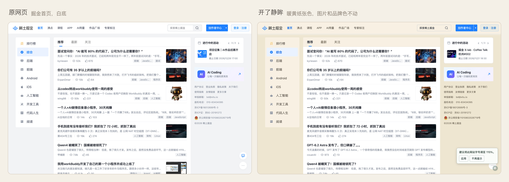
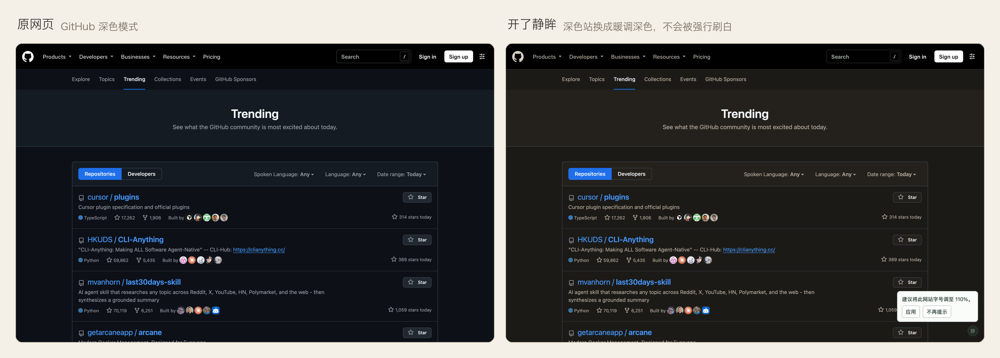
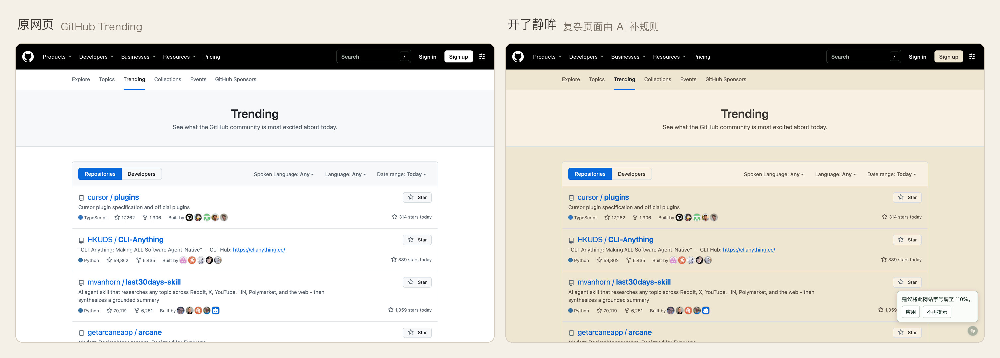
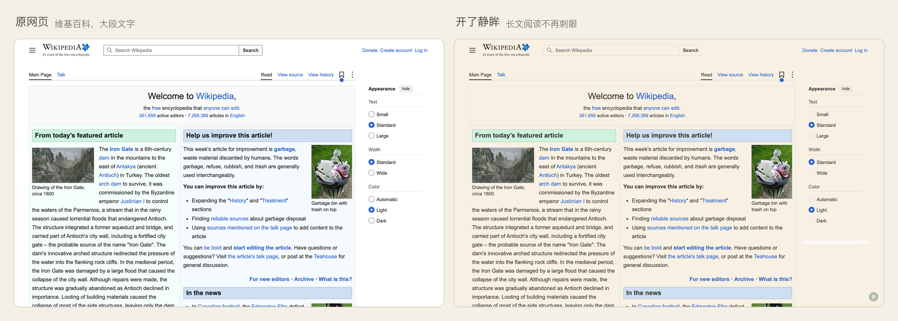
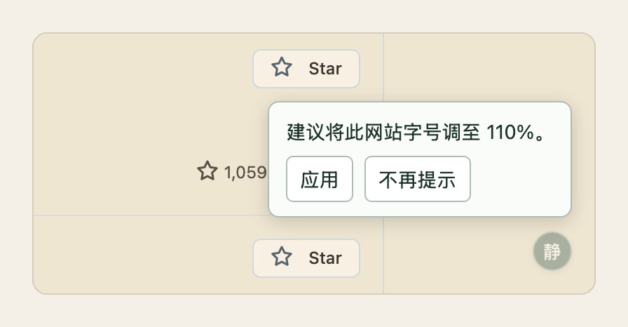
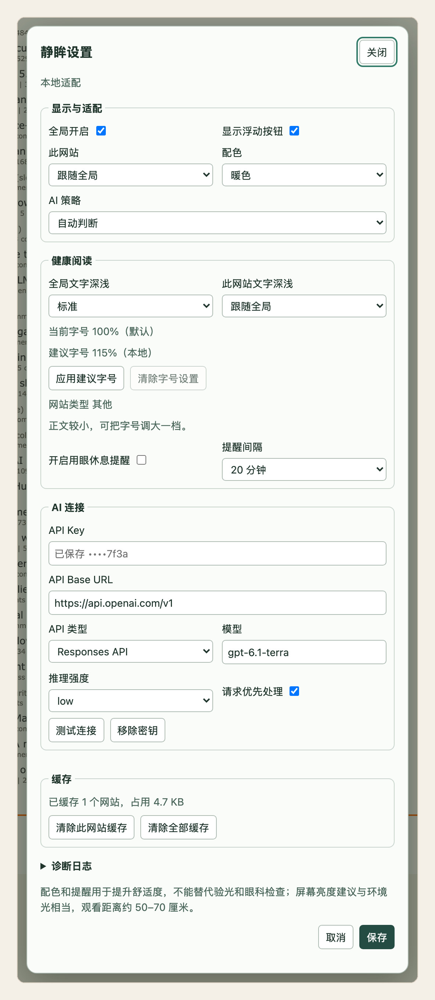

  

  
  
  

# 静眸 EyeCalm

静眸是一个护眼用户脚本：**浅色网站换成暖黄纸张色，深色网站换成暖调深色，图片、视频和品牌色尽量保持原样。** 普通网页在本地就能适配；结构复杂的页面，可以接你自己的 OpenAI 兼容接口，让 AI 补一份配色规则。不接 AI 也能用。

它和一键暗黑类工具的区别在于：静眸先判断网站本来是亮还是暗，再顺着原样调成护眼配色，不会把所有网站都强行变黑，也不会把深色网站刷白。

## 效果

左边是原网页，右边是开了静眸。

**浅色网站 → 暖黄纸张**（掘金首页）

**深色网站 → 暖调深色，不会被刷白**（GitHub 深色模式）

**复杂页面 → AI 补一份规则**（GitHub Trending）

再看一张：维基百科长文

## 特点

- **跟随网站原有明暗**：在视口里抽样可见的不透明背景，判断网站本来是浅色还是深色；网站自己切换主题时，静眸会重新检测并跟着切换。
- **只换中性色**：背景、正文、边框换成护眼配色；图片、视频、画布、SVG 和显眼的品牌色尽量不动。
- **本地优先，AI 可选**：普通网页本地即可适配；复杂页面可选 AI 补规则。规则会缓存（AI 规则 30 天、本地规则 7 天），不会每次打开都请求。
- **健康阅读**：字号建议、文字对比度达标（普通文字至少 4.5∶1），以及可选的休息提醒。
- **按网站开关**：每个网站单独记住开关和字号，不影响别的网站。
- **单文件、无依赖**：没有自建服务器；只有在你配置了 AI 时，才会请求你自己填写的接口。

## 安装

1. 安装脚本管理器：[Tampermonkey](https://www.tampermonkey.net/)（Chrome、Edge、Firefox 等）或 [Violentmonkey](https://violentmonkey.github.io/)。
2. 点击 **[一键安装静眸](https://raw.githubusercontent.com/ndj888/eyecalm/main/eyecalm.user.js)**，在脚本管理器弹出的页面中点「安装」。
3. 刷新任意网页，右下角出现「静」就说明已经生效。

> [!TIP]
> Chrome 系浏览器装好脚本却毫无反应时，打开 `chrome://extensions`，在 Tampermonkey 的「详情」里打开「允许用户脚本」；部分版本需要打开扩展页右上角的「开发者模式」。

脚本会从本仓库自动更新。Tampermonkey 默认每天检查一次，也可以在脚本菜单里手动「检查更新」。旧版无法检查更新时，用上面的链接覆盖安装一次即可，无需先卸载。

## 使用

切换当前网站的开关，三种方式任选：

- 点右下角的「静」
- 按 `Alt+Shift+E`
- 在脚本管理器的菜单中选「静眸：此网站」

开关按网站（hostname）保存。脚本管理器菜单里还有：

- **用 AI 重新适配此网站**：配色不对劲时，让 AI 重新生成规则
- **清除此网站缓存**：网站改版后样式异常时，清除后刷新
- **设置**：全局开关、配色（暖色 / 浅绿）、浮动按钮、AI 连接、健康阅读和缓存管理

 

### 快捷键

| 快捷键 | 作用 |
| --- | --- |
| `Alt+Shift+E` | 开关当前网站 |
| `Alt+Shift+=` | 本站字号 +5% |
| `Alt+Shift+-` | 本站字号 −5% |
| `Alt+Shift+0` | 清除本站字号 |

macOS 上的 `Alt` 即 `Option`。

## AI 适配（可选）

不填写 API Key 也能使用本地适配。需要 AI 时，在「设置 → AI 连接」中填写：

- **API Key**：你自己的密钥。保存后只显示末四位；留空且不编辑会保留原密钥，选「移除密钥」后保存可删除。
- **Base URL**：默认 `https://api.openai.com/v1`。需要 HTTPS，本机地址可用 HTTP。
- **API 类型**：默认 Responses API；中转或其他兼容服务可切换到 Chat Completions。
- **模型与推理强度**：默认 `gpt-6.1-terra`、`low`，可自行修改。
- **请求优先处理**：默认开启；服务不支持时关闭即可。

填好后先点「测试连接」检查配置和耗时，再点「保存」。

「AI 策略」有三档：**自动判断**（默认，复杂页面才请求）、**始终使用 AI**、**仅本地适配**（不发自动请求）。

第一次打开复杂页面时，静眸会先保留网页原色，等 AI 返回后再换；之后直接使用缓存。请求失败时会保留可用的缓存或改用本地配色，同一网站连续失败后自动重试的间隔依次为 10 分钟、1 小时、6 小时和 24 小时；手动「用 AI 重新适配此网站」可立即重试。

 

## 隐私

- AI 请求只包含：网站域名、颜色和颜色变量、有限的结构选择器（包括类名）及其使用频率、本地推断的颜色角色，以及首屏字号、行高、正文宽度等排版统计。
- AI 请求**不包含**网页正文、表单输入、完整链接或截图。
- API Key 单独保存在脚本管理器的存储中；设置面板使用封闭 Shadow DOM，不会回填完整密钥。请在可信页面录入密钥，网页可能监听键盘事件。
- 选择「仅本地适配」后不会发起自动 AI 请求；手动重新适配和测试连接仍会请求。

## 健康阅读

- **字号建议**：根据首屏正文的字号和占用面积给出建议，点击「应用」后才生效，下次打开沿用。
- **文字深浅**：标准档让普通文字对比度至少 4.5∶1、大字至少 3∶1；链接和辅助文字尽量保留原有色相。「加深」「更深」可以进一步提高辅助文字的对比度，全局和单个网站都能设置。
- **休息提醒**：默认关闭，可选 20、30 或 60 分钟。按 20-20-20 规则，约每 20 分钟看向约 6 米外至少 20 秒。

静眸调整的是页面配色和字号，用于提升阅读舒适度，**不能防止近视加深，也不能替代验光和眼科检查**。参考：[W3C 对比度说明](https://www.w3.org/WAI/WCAG22/Understanding/contrast-minimum.html) · [AAO：20-20-20](https://www.aao.org/eye-health/tips-prevention/what-is-eye-strain) · [AOA：数字视疲劳](https://www.aoa.org/healthy-eyes/eye-and-vision-conditions/computer-vision-syndrome)

## 支持范围与常见问题

静眸适配普通 HTML 和可访问的开放 Shadow DOM。浏览器内部页面、扩展商店、独立 iframe、封闭 Shadow DOM 和脚本无权访问的样式无法覆盖；复杂应用中的透明层叠、渐变和语义色可能需要 AI 规则。

<b>网页完全没有变化</b>

先刷新页面，再检查脚本管理器是否允许在该网站运行、本站和全局开关是否打开。菜单或设置里显示「此网站由其他脚本处理」时，说明该页面已有其他护眼脚本接管，静眸会主动让出。

<b>AI 适配失败</b>

在设置里用「测试连接」检查 Base URL、API 类型、模型和密钥权限。若服务不支持优先处理或自定义推理强度，关闭对应设置。最近一次错误会显示在菜单「用 AI 重新适配此网站」和设置中。

<b>网站改版后样式异常</b>

在菜单中选「清除此网站缓存」后刷新，或选「用 AI 重新适配此网站」。如果只有部分区域需要保留原色，可以关闭本站适配。

## 反馈

欢迎提交 [Issue](https://github.com/ndj888/eyecalm/issues)，附上网址和截图会很有帮助。设置中的「诊断日志」可以查看最近的适配记录，「复制诊断信息」会复制最近的 JSON 记录（站点、结果、HTTP 状态、耗时等），一并贴上能更快定位问题。

## 许可

以 [MIT 许可证](LICENSE)开源。`eyecalm.user.js` 即全部源码，无闭源部分。

## 友情链接

- [LINUX DO](https://linux.do)：新的理想型社区。静眸在这里发布和收集反馈。
